# Ideomod

This is an incomplete prototype for my vision of a vanilla++ style overhaul of Minecraft. The full vision is roughly outlined, as recorded by Claude, in the [design document](docs/dev/IDEOMOD_DESIGN.md).

What exists so far mainly centres on Oddstone and on expansions to sticky blocks, flying machines, and moving blocks and contraptions in general.

### Disclaimers

- The implementation and development of this mod was almost entirely handled and written by Claude, directed by me.
- Almost all textures were made by me, influenced by some vanilla textures. The Oddstone texture was generated with Stable Diffusion and cleaned up by Claude. The other Oddstone-family textures were generated algorithmically by Claude, using the same colour palette with Minecraft's textures as reference. The Machine Frame and Drill textures were also made by Claude.

**Status: work in progress.** This repository is a snapshot of where the mod is today. A build of it, version 0.1.0, is on the [Releases page](https://github.com/Socratique/Ideomod-Public/releases): put the jar in the `mods` folder of a Minecraft 1.20.1 Forge install. Things will change, and some parts are rough (see [Known rough edges](#known-rough-edges)).

| | |
|---|---|
| Minecraft | 1.20.1 |
| Loader | Forge 47.x (built against 47.4.10) |
| Mod version | 0.1.0 |
| Java | 17 |

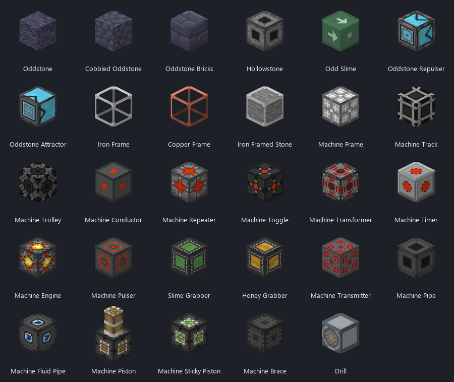

## Contents

- [About the pictures](#about-the-pictures)
- [Building and running](#building-and-running)
- [Oddstone](#oddstone)
- [Odd Slime](#odd-slime)
- [Oddstone Repulser and Attractor](#oddstone-repulser-and-attractor)
- [Oddstone Portals](#oddstone-portals)
- [Hollowstone](#hollowstone)
- [The Machine Family](#the-machine-family)
- [Frames and Framed Blocks](#frames-and-framed-blocks)
- [Furnace Array](#furnace-array)
- [Smaller things](#smaller-things)
- [What changes about vanilla pistons](#what-changes-about-vanilla-pistons)
- [World generation](#world-generation)
- [Recipes](#recipes)
- [Configuration and commands](#configuration-and-commands)
- [Known rough edges](#known-rough-edges)
- [Repository layout](#repository-layout)
- [License](#license)

## About the pictures

The isometric animations in this README are **illustrations, not screen captures**. They are drawn by a small script ([`tools/renders`](tools/renders)) from the mod's own textures, and each one replays by hand what the code does in that situation. They exist to make the rules easy to see.

The GUI pictures are drawn the same way, from the mod's own GUI textures, by [`tools/renders/gui.py`](tools/renders/gui.py).

Real footage from the game is in [In-game footage](#in-game-footage) at the end of the Oddstone section.

## Building and running

You need JDK 17. From the repository root:

```
./gradlew build        # builds build/libs/ideomod-0.1.0.jar
./gradlew runClient    # starts a development client with the mod loaded
```

The first run downloads Forge and decompiles Minecraft, which takes a while.

To check that a built jar really loads, run `scripts/check_jar.sh`. It starts a real Forge server with the jar in its `mods` folder and fails if the mod does not load or the server crashes. GitHub runs the same check on every push ([](https://github.com/Socratique/Ideomod-Public/actions/workflows/check.yml)).

In game, everything is in the **Ideomod** creative tab. A second tab, **Framed Blocks**, lists every framed block.

## Oddstone

Oddstone is a dark stone found underground. It is the centre of the mod: most of the other blocks either are made from it or react to it.

It comes in three full blocks (Oddstone, Cobbled Oddstone, Oddstone Bricks), each with a wall, stairs and slab. They do not all share the same properties:

| | Oddstone | Cobbled / Bricks | Walls, stairs, slabs |
|---|:---:|:---:|:---:|
| Sympathetic movement | yes | yes | yes |
| Grabs slime, honey and Odd Slime | yes | yes | no |
| Mobs avoid it | yes | yes | no |
| Blocks redstone like glass does | yes | yes | no |
| Forms portal frames | yes | no | no |
| Cools lava into Hollowstone | yes | no | no |

### Sympathetic movement

When a piston moves an Oddstone block, other Oddstone blocks of the same kind move with it, without touching it.

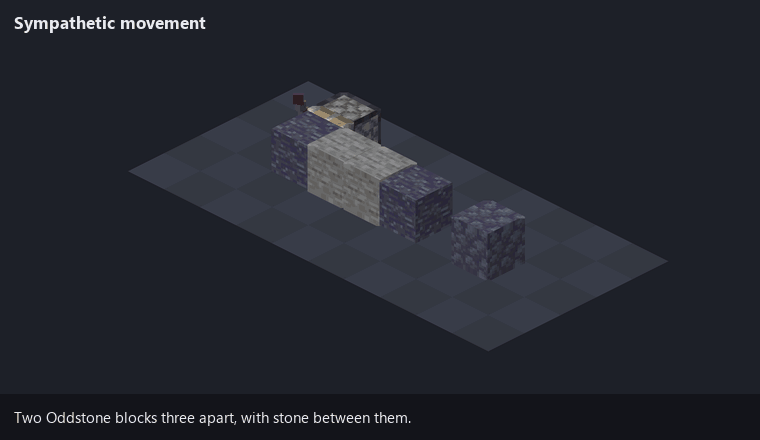

The rule:

- From the moved block, the mod looks along the six axis lines (not diagonals), up to 5 blocks each way.
- The first block of the **same channel** found in each direction is linked and moves too. Whatever sits in between, solid or not, is ignored.
- Links chain: each linked block looks along its own six lines.
- Every block type is its own channel, so there are twelve: Oddstone, Cobbled Oddstone, Oddstone Bricks, and the wall, stairs and slab of each. Oddstone never links with Cobbled Oddstone.
- A linked block moves the way any pushed block does. It pushes what is in front of it and brings along anything stuck to it.
- Everything counts toward the one piston push limit (12, or more with [Machine Braces](#brace)).

A sticky piston cannot pull a sympathetic block directly. It retracts and leaves the block where it is.

### One-way stickiness

Oddstone, Cobbled Oddstone and Oddstone Bricks grab slime blocks, honey blocks and Odd Slime. Nothing can grab them back.

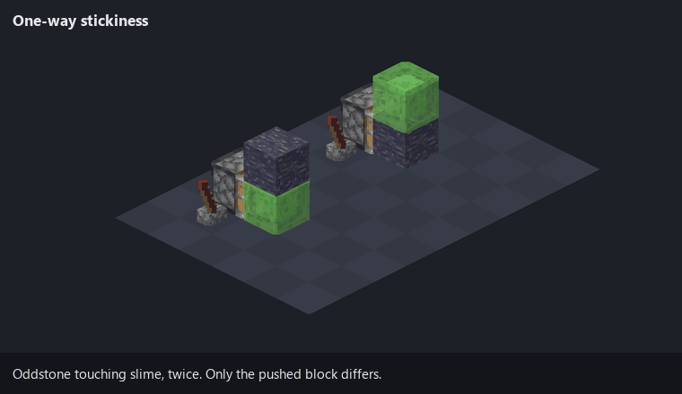

They only grab those sticky blocks. They do not grab ordinary blocks, and they do not grab each other by contact, because Oddstone-to-Oddstone connections go through sympathetic movement instead.

### Mob avoidance

Mobs path around Oddstone, Cobbled Oddstone and Oddstone Bricks, and treat the blocks next to them as dangerous. The list of affected mobs is in the config (62 vanilla mobs by default).

### Redstone insulation

The three full blocks do not conduct redstone. A powered Oddstone block does not power what is behind it, the same as glass.

### In-game footage

Recorded in the game in April 2026.

| Sympathetic movement | Repulser and Attractor |
|---|---|
| 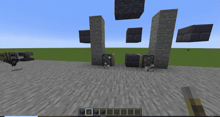 | 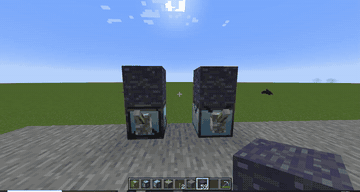 |
| **Portal** | **Mob avoidance** |
| 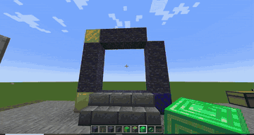 | 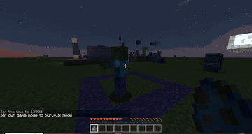 |

## Odd Slime

A slime block with a direction. It is sticky on all six sides, but only when it is pushed the way it faces. Pushed any other way it behaves like an ordinary block and takes nothing with it.

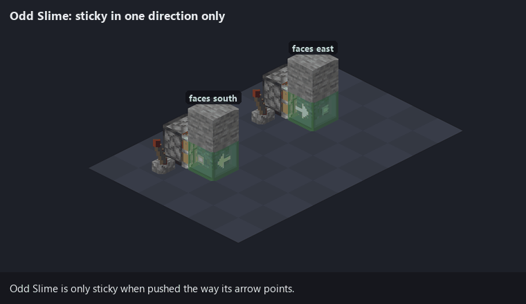

It is placed like a piston, facing you. It never sticks to slime or honey blocks, and it cannot grab Oddstone.

## Oddstone Repulser and Attractor

Two blocks that move Oddstone at a distance. Each acts along the line it faces, up to 12 blocks, and ignores whatever is in between.

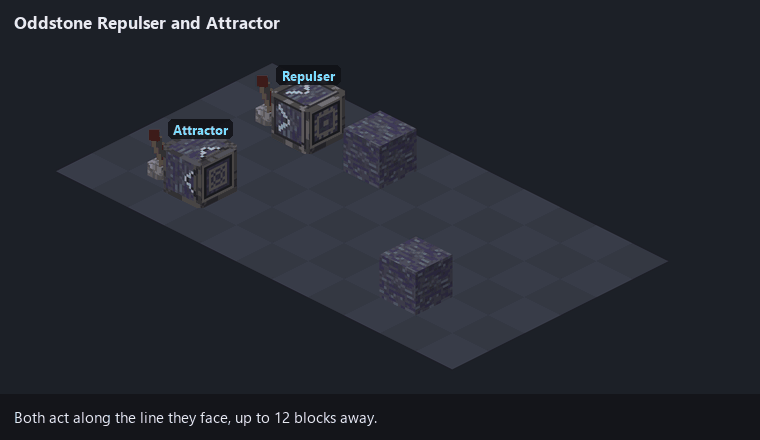

- **Repulser:** on each redstone pulse, pushes the *nearest* Oddstone on its line one block away.
- **Attractor:** on each redstone pulse, pulls the *farthest* Oddstone on its line one block closer.

They act on a rising edge, so one pulse is one block. The target is plain Oddstone or a Framed Oddstone. The move is a normal piston move starting at the target, so stickiness, sympathetic links and the push limit all apply. Nothing happens if the move is blocked or would push a block into the device.

## Oddstone Portals

A portal frame is an upright rectangle of Oddstone with a mineral block at each of the four corners.

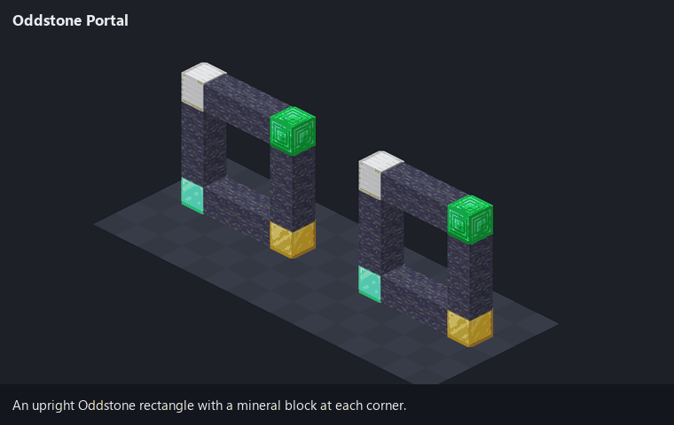

- **Shape:** vertical only. The opening is 3 to 19 blocks wide and 3 to 19 tall, and must be empty.
- **Corner blocks:** blocks of coal, iron, copper, gold, redstone, lapis, diamond, emerald, netherite, quartz or amethyst, or raw iron, raw copper or raw gold blocks.
- **Lighting it:** throw an ender pearl at the frame. The pearl is used up and you are not teleported by it.
- **Address:** the four corner blocks are the portal's address. It reads the same from both sides.
- **Linking:** the first portal with a given address is unlinked. A second portal with the same address, in the same dimension, links to it. A third will not light.
- **Linked portals:** walking in puts you at the matching spot in the other portal, facing out of it. This works between portals of different sizes.
- **Unlinked portals:** walking in throws you 200 to 1000 blocks in a random direction, onto the surface, and costs 5 hearts.
- **Limits:** players only, with a 4 second cooldown.
- **Closing:** break or move any frame Oddstone or corner block. The partner becomes unlinked.

## Hollowstone

Hollowstone forms where Oddstone meets lava. Any lava *source* block touching Oddstone turns into Hollowstone. Flowing lava does not, and the Oddstone is not used up.

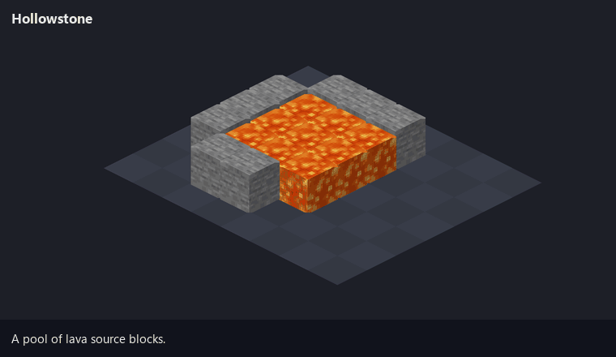

- Right-click an empty Hollowstone with a block to put that block inside it. This is for looks only. Blocks with inventories or other stored data cannot go in.
- Mined normally it drops 5 to 7 Hollowstone Shards (Fortune applies). Nine shards craft back into one Hollowstone. Silk Touch drops the block itself.
- When a filled Hollowstone is mined without Silk Touch, the block inside is left standing in its place.

## The Machine Family

The Machine Frame is one block that becomes many. Right-click it to open a one-slot GUI. The item you put in the slot decides what the block is. Take the item out and it is a Machine Frame again.

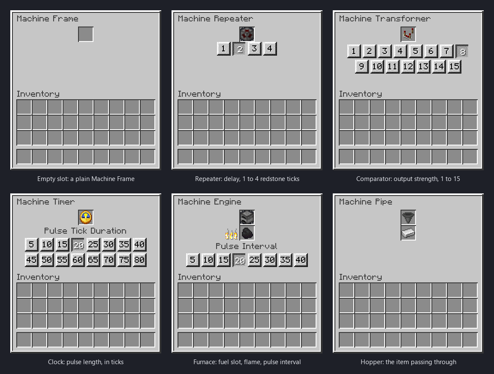

The GUI changes with the item in the slot. Most machine blocks show only the slot; the six above are the ones with more to them.

| Put this in the slot | It becomes |
|---|---|
| *(nothing)* | [Machine Frame](#machine-frame) |
| Redstone Dust | [Machine Conductor](#conductor) |
| Repeater | [Machine Repeater](#repeater) |
| Lever | [Machine Toggle](#toggle) |
| Comparator | [Machine Transformer](#transformer) |
| Clock | [Machine Timer](#timer) |
| Any button | [Machine Pulser](#pulser) |
| Furnace | [Machine Engine](#engine) |
| Any Oddstone-family block | [Machine Transmitter](#transmitter) |
| Piston | [Machine Piston](#machine-piston-and-sticky-piston) |
| Sticky Piston | [Machine Sticky Piston](#machine-piston-and-sticky-piston) |
| Machine Frame | [Machine Brace](#brace) |
| Powered Rail | [Machine Track](#track-and-trolley) |
| Minecart | [Machine Trolley](#track-and-trolley) |
| Slime Block | [Machine Slime Grabber](#grabbers) |
| Honey Block | [Machine Honey Grabber](#grabbers) |
| Hopper | [Machine Pipe](#item-pipe) |
| Bucket (empty) | [Machine Fluid Pipe](#fluid-pipe) |

Things all machine blocks share:

- **They stick together.** A Machine Frame sticks to every machine block. A specialised block sticks only to its own kind and to Machine Frames. So a Track does not stick to a Trolley, and a Piston does not stick to a Sticky Piston.
- **They keep their contents when moved.** Pistons can push them, and the slot item, settings, timers, fuel and held items all survive the move.
- **Slime can grab them, they cannot grab slime.** The exception is a switched-on [Grabber](#grabbers).
- **They drop as what they are.** A broken Machine Timer drops a Machine Timer with its clock inside. The creative tab has every kind ready-made.
- **Settings reset on a swap.** Changing the slot item makes a new block, so a new Repeater starts at delay 1.

### The redstone blocks

Repeater, Toggle, Transformer, Timer, Pulser and Engine share one model. The face receiving the strongest signal is the **input**. The block outputs on the **other five faces**, and it powers through solid blocks as a vanilla repeater does. Each has a coloured indicator that is dark when off and red when on.

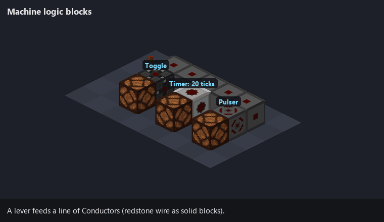

#### Conductor

Redstone wire as a solid block. Signal strength drops by 1 per Conductor, as with dust. It takes input on one face and outputs on the other five. The indicator gets brighter with signal strength.

#### Repeater

Outputs full strength (15) while its input is on. The GUI has four buttons for the delay: 1 to 4 redstone ticks. It cannot be locked.

#### Toggle

A flip-flop. Each time the input goes from off to on, the output flips. The input has to go off and come back on before it flips again. A signal that is already on when you place the Toggle is ignored until it drops.

#### Transformer

Outputs a strength you choose, from 1 to 15, whenever its input is on at any strength. The GUI has fifteen buttons.

#### Timer

When the input turns on, outputs full strength for a set time, then stops. The time always runs to the end, whatever the input does. It fires again only after the input has gone off and come back. The GUI offers sixteen durations, 5 to 80 ticks by default (20 ticks = 1 second).

#### Pulser

A Timer with a fixed, very short output: one redstone tick (2 game ticks). It turns any signal into a single short pulse.

#### Engine

A clock that runs on fuel. While it has a redstone signal and fuel, it gives a short full-strength pulse at a regular interval.

- Fuel is anything a furnace burns, for as long as a furnace would burn it. Fuel is only used while the Engine has a signal.
- The GUI has a fuel slot, a flame gauge and eight interval buttons: 5 to 40 ticks by default.
- Hoppers and Machine Pipes can feed the fuel slot.
- A comparator reads how full the fuel slot is.

#### Transmitter

Wireless redstone. The Oddstone-family block in the slot is the **channel**. Twelve blocks, twelve channels.

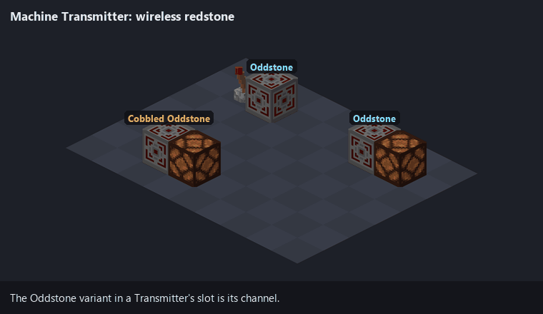

- A Transmitter that receives redstone becomes a **source**. It outputs nothing itself.
- Every other Transmitter on the same channel within 5 blocks in each direction becomes a **receiver**, and outputs the source's strength minus 1 on all six faces.
- Receivers do not relay to further receivers.
- If several sources are in range, the strongest wins.
- The range is the same config value as the sympathetic movement range.

### Movement blocks

#### Machine Piston and Sticky Piston

A piston with no front. A signal on one face extends an arm from the opposite face. Signals on several faces extend several arms at once.

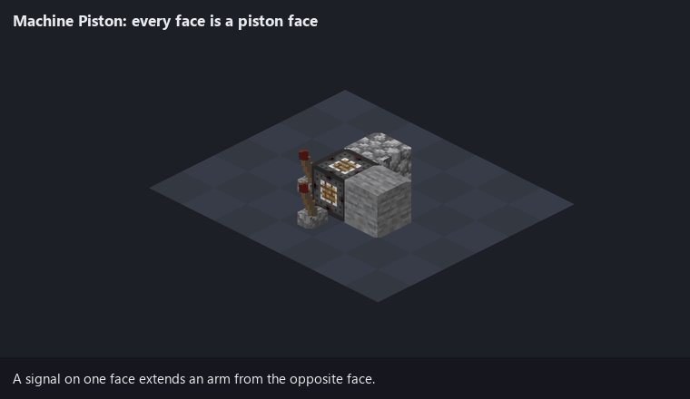

- Each arm stays out while its signal lasts, and retracts when it goes.
- It pushes as a vanilla piston does, with the same push limit.
- The sticky version pulls the block in front of the arm back when it retracts.
- It cannot be moved by another piston while an arm is out.

#### Brace

Raises the piston push limit. Each Brace in the group being moved adds 6 to the limit of 12, up to eight Braces and a limit of 60.

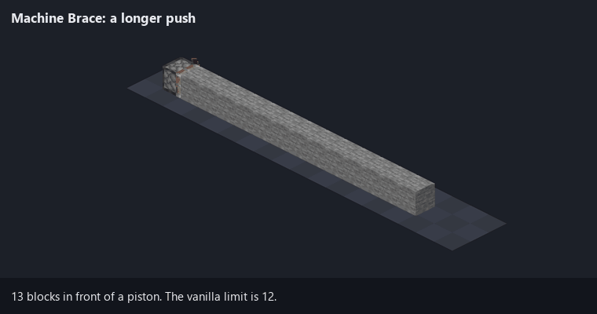

This applies to vanilla pistons, Machine Pistons, Tracks, Repulsers and Attractors. A Brace has to be within reach at the current limit to count, so put the first one near the piston.

#### Track and Trolley

A Track pushes Trolleys. When a Track's signal turns on, every Trolley touching it moves one block, away from the side the signal came from. Lay Tracks in a line, set a Trolley on top, and power the line from one end: each pulse moves the Trolley one block along it.

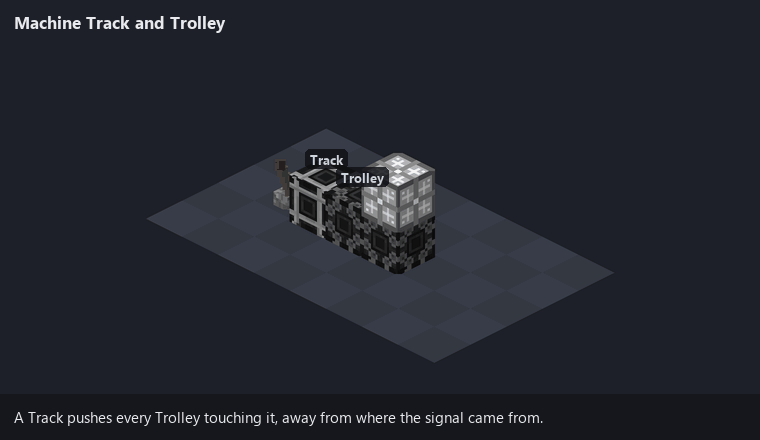

- One pulse moves a Trolley one block.
- The Trolley moves as a pushed group, so it carries what is stuck to it: other Trolleys, Machine Frames, and anything those hold.
- Tracks pass their signal along to neighbouring Tracks, losing 1 strength per Track. They do not power anything else.
- The Trolley itself does nothing. It is the thing that gets moved.

#### Grabbers

A slime block or honey block with a switch. Each redstone pulse flips it on or off.

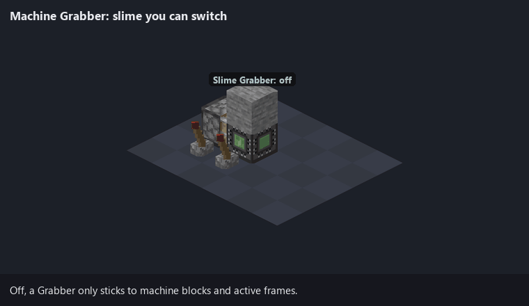

- **Off:** it sticks only to machine blocks and active frames.
- **On:** it also grabs as a slime block (Slime Grabber) or honey block (Honey Grabber) does.

For one tick after being moved by a piston, Grabbers and Toggles ignore redstone changes, so a contraption does not flip its own switches while its parts land.

### Transport blocks

#### Item Pipe

Passes items along, one at a time, at hopper speed.

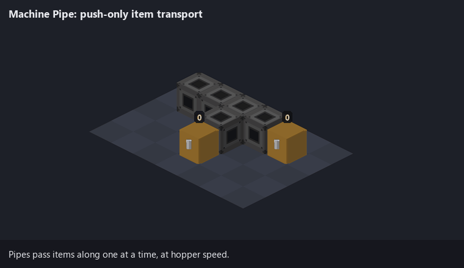

- **Push only.** A pipe never pulls from a container and never drops items on the ground.
- It pushes into anything that accepts items from that side: chests, hoppers, other pipes, an Engine's fuel slot.
- It prefers to send items straight on from the face they came in. With more than one valid output it takes turns between them. It never sends an item back the way it came.
- A redstone signal stops it, as with a hopper.
- Items get in through the GUI, from a hopper, or from another pipe.
- A comparator reads how full it is.

#### Fluid Pipe

Holds one bucket of water or lava.

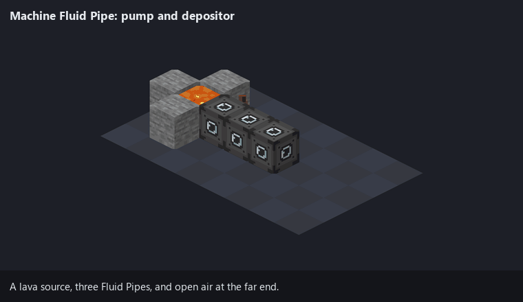

- **Powered and empty,** it takes an adjacent water or lava source block, or empties a full cauldron. Flowing fluid is ignored.
- **Holding fluid,** powered or not, it passes it to the next empty Fluid Pipe. If there is none, it places the fluid in the world: a source block into air, or into a cauldron.
- The redstone logic is the reverse of the Item Pipe: here a signal means "pump".
- Water meeting lava inside a pipe uses up both and leaves obsidian in the slot, which turns that pipe back into a Machine Frame.
- A pipe holding lava gives off light. A comparator reads empty or full.

### Machine Frame

With an empty slot, the Machine Frame is the connector. It sticks to every machine block, which makes it the glue of a contraption. It is also what switches [frames](#frames-and-framed-blocks) off.

## Frames and Framed Blocks

Iron Frames and Copper Frames are see-through blocks that are only sticky while they are **active**.

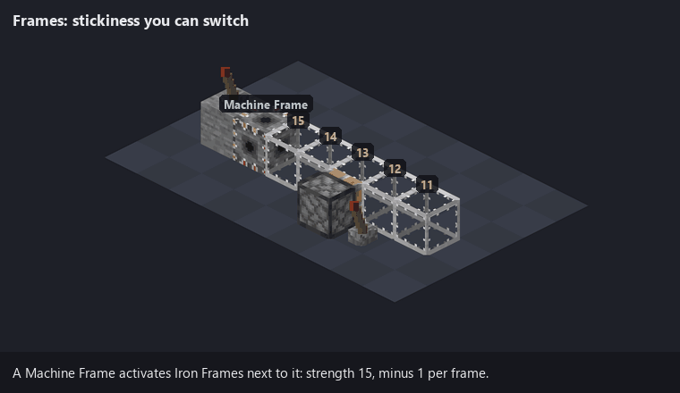

How activation works:

- Any machine block touching a frame activates it at strength 15. Each further frame in the chain gets 1 less. A frame with strength above 0 is active, so a chain reaches 15 frames from its source.
- Activation only travels through frames of one metal. Iron passes it to iron, copper to copper.
- An active frame sticks to other active frames of the same metal and to machine blocks. It does not grab ordinary blocks.
- **A Machine Frame that is powered by redstone does the opposite.** It stops activating and sends an "off" signal of the strength it receives, which also drops by 1 per frame. Any frame that signal reaches is inactive, whatever else is activating it. Only the plain Machine Frame does this. Specialised machine blocks always activate.

So a row of frames is a rigid beam when active, and a row of loose blocks when not, and a lever decides which.

Frames can be waterlogged.

### Framed Blocks

Craft a frame with a block and you get that block inside a frame: Iron Framed Stone, Copper Framed Glass, and so on. About 340 blocks can be framed (the `ideomod:frameable_blocks` tag, which datapacks can extend).

A framed block:

- behaves as a frame for stickiness, and activates the same way;
- keeps most of what the inner block does: hardness and tool, sounds, light, redstone output, slipperiness, and walking effects such as soul sand's slowness or honey's low jump;
- takes a little longer to mine than the inner block, always needs a pickaxe, and drops as the framed block;
- moves with pistons and keeps its inner block.

Some inner blocks add behaviour:

- **Framed slime, honey or Odd Slime** is sticky in the inner block's own way even when the frame is inactive.
- **Framed Oddstone** grabs slime-type blocks, moves sympathetically on the Oddstone channel, and counts as Oddstone for the Repulser and Attractor.
- **Framed obsidian, crying obsidian or reinforced deepslate** cannot be moved at all. Stuck into a contraption, it anchors the whole thing.

Looking at a framed block with F3 open shows the inner block on the right-hand side.

## Furnace Array

A multiblock. Wall furnaces into a stone shell and they cook 50% faster.

> **Note:** the Furnace Array is an example, built to test the mod's multiblock system. It shows what that system can do; it is not a finished feature.

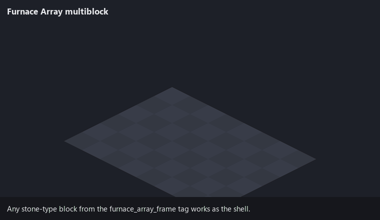

- **Core:** a filled rectangle of furnaces, all the same type (furnace, blast furnace or smoker) and all facing the same way. Up to 5 wide and 5 tall by default.
- **Shell:** a box one block larger on every side and three blocks deep. The back layer is solid. The middle layer rings the furnaces. The front layer is a ring too, with air in front of every furnace so you can reach it. One furnace needs 25 shell blocks.
- **Shell blocks:** 38 stone-type blocks (the `ideomod:furnace_array_frame` tag): stone and stone bricks, deepslate variants, bricks, polished stones, blackstone, nether bricks, quartz, cut copper, Machine Frames and others. You can mix them.
- **Effect:** each furnace is renamed "Enhanced Furnace" (or Blast Furnace, or Smoker) and cooks 50% faster. Fuel burns at the usual rate, so each piece of fuel cooks more.
- The structure is found when you place or break a block near it, and stops working when the shell is broken.

## Smaller things

**Redstone Rod.** A hand tool. Right-click a block face to give that block a full-strength redstone pulse from that side, one redstone tick long. It fires before the block's own right-click, so it does not open GUIs. Good for testing a contraption by hand.

**Drill.** On a redstone pulse, breaks the 3×3 area of blocks directly in front of it, one block deep, and drops the items at the drill.

**Judgement.** When a player kills an animal or a villager, there is a 1 in 200 chance that every animal and villager within 32 blocks stops and turns to stare at the player for five seconds.

**Structure Debug Stick.** A creative-only tool. While you hold it, chat reports when a Furnace Array forms or breaks and what portals are doing.

## What changes about vanilla pistons

The mod alters how the piston works out what to move. In play that means:

- Blocks can be sticky in one direction only, or only towards certain blocks (Oddstone, Odd Slime, machine blocks, frames).
- Sympathetic blocks join a move from a distance.
- Machine Braces raise the push limit.
- Machine blocks and framed blocks can be pushed and keep their stored data. Vanilla chests, furnaces and the like are still immovable.
- A sticky piston will not pull a sympathetic block directly.

Slime and honey blocks behave as in vanilla, except that they cannot grab Oddstone or Odd Slime.

## World generation

- **Oddstone** generates as an ore in every overworld biome: veins of up to 7, replacing stone and deepslate, five tries per chunk below Y 0 and three between Y 0 and 63.
- **Hollowstone formations** generate at underground lava: a few Oddstone blocks on the shore of a lava pool, with the lava next to them turned to Hollowstone.
- **Ore Only (Debug)** is an extra world type. It generates the overworld and then removes everything that is not an ore, Oddstone or Hollowstone. It is for checking ore distribution.

## Recipes

| Result | Recipe |
|---|---|
| Machine Frame ×4 | Iron ingot in the centre, redstone dust above, below, left and right |
| Iron Frame ×4 / Copper Frame ×4 | Four ingots in a diamond shape |
| Framed block | One frame and one frameable block, anywhere in the grid |
| Odd Slime | Slime block and Oddstone, anywhere in the grid |
| Oddstone Bricks ×4 | 2×2 Oddstone |
| Cobbled Oddstone | Smelt Oddstone, or mine Oddstone with Silk Touch |
| Stairs, slabs, walls | The usual shapes, or the stonecutter |
| Hollowstone | Nine Hollowstone Shards |
| Redstone Rod | Redstone torch over iron ingot over stick, in a column |
| Drill | Piston in the centre, redstone below it, iron ingots in the other seven slots |

Oddstone itself only comes from the world. The Repulser, Attractor and Structure Debug Stick have no recipe yet and are creative-only.

Mining Oddstone with a normal pickaxe drops Oddstone. Silk Touch gives Cobbled Oddstone, the reverse of vanilla stone.

## Configuration and commands

The config file is `config/ideomod/ideomod.json`, created on first launch.

| Section | Key | Default | What it sets |
|---|---|---|---|
| `oddstone` | `sympathetic_radius` | 5 | Range of sympathetic links and of Transmitters |
| `oddstone` | `affected_mobs` | 62 mobs | Which mobs avoid Oddstone |
| `pistons` | `ranged_scan_range` | 12 | Reach of the Repulser and Attractor |
| `pistons` | `base_push_limit` | 12 | Piston push limit before Braces |
| `machine_braces` | `push_limit_per_brace` | 6 | Extra blocks per Brace |
| `machine_braces` | `max_braces` | 8 | How many Braces count |
| `machine_braces` | `max_push_limit` | 60 | Cap on the push limit |
| `pipes` | `item_transfer_cooldown` | 8 | Ticks between items (8 = hopper speed) |
| `pipes` | `fluid_transfer_cooldown` | 8 | Ticks between fluid transfers |
| `portals` | `teleport_cooldown` | 80 | Ticks between portal uses |
| `portals` | `scatter_distance_min` / `_max` | 200 / 1000 | How far an unlinked portal throws you |
| `portals` | `scatter_damage` | 10.0 | Damage from an unlinked portal (10 = 5 hearts) |
| `judgement` | `chance` | 200 | 1 in N chance of Judgement |
| `judgement` | `radius` | 32.0 | Blocks searched for mobs |
| `judgement` | `duration_ticks` | 100 | How long they stare |
| `furnace_array` | `max_width` / `max_height` | 5 / 5 | Largest furnace rectangle |
| `timer` | `durations` | 5 to 80, step 5 | Timer GUI buttons, in ticks |
| `timer` | `default_index` | 3 | Default Timer button (20 ticks) |
| `engine` | `durations` | 5 to 40, step 5 | Engine GUI buttons, in ticks |
| `engine` | `default_index` | 3 | Default Engine button (20 ticks) |
| `pulser` | `pulse_duration` | 2 | Pulser output length, in ticks |

Commands, both for operators:

- `/ideomod reload` re-reads the config file.
- `/judgement` triggers the Judgement effect on yourself.

## Known rough edges

This is a snapshot, so here is what is known to be unfinished. Most of these come from reading the code and have not all been checked in the game.

- **No recipes** for the Repulser, Attractor and Structure Debug Stick.
- **Placeholder art** on some machine blocks (Timer, Engine, Transmitter).
- **Hollowstone** loses its inner block when mined with Silk Touch or destroyed by anything other than a player, and cannot be moved by pistons.
- **Mixed iron and copper frame networks** may leave a frame inactive that should be active. Chains of one metal are fine.
- **Furnace Array size limits** are read at startup, so `/ideomod reload` does not change them until a restart.
- **A full Fluid Pipe** that is broken drops holding its filled bucket, and turns into a plain Machine Frame when placed again.
- **A Transmitter receiver** read directly by another machine redstone block counts as on or off only. Redstone dust and Conductors see the real strength.
- **Sympathetic links and the push limit:** a linked block that would take a move over the limit appears to be left behind rather than stopping the move.
- **Debug logging** is still switched on in a few places and is noisy.
- **No world generation beyond the ores.** The larger overhaul sketched in the design notes has not been started.

## Repository layout

```
src/main/java/com/ideomancer/ideomod/
  block/            Oddstone family, Odd Slime, Hollowstone, Drill
  block/machine/    the Machine Family
  block/frame/      frames, framed blocks, frame activation
  block/movement/   stickiness rules and the shared block mover
  block/piston/     Repulser and Attractor
  block/portal/     Oddstone portals
  multiblock/       multiblock framework and the Furnace Array
  mixin/            the piston, furnace and entity hooks
  worldgen/         ore-only world type, Hollowstone formations
  config/ client/ network/ registry/ item/ effect/
src/main/resources/ models, textures, recipes, loot tables, tags, worldgen
docs/dev/           working notes: design, technical reference, changelog, audits
docs/media/         the pictures in this README
tools/renders/      the script that draws the illustrations
scripts/            small Windows helper scripts
```

The notes in [`docs/dev`](docs/dev) are the project's working documents. They are long, detailed, and in places behind the code. This README was checked against the code and is the better guide to what the mod does today.

To redraw the illustrations: `python tools/renders/scenes.py` and `python tools/renders/gui.py` (needs Python 3 and Pillow).

## License

[Mozilla Public License 2.0](LICENSE). In short: you can use, change and redistribute this mod, and include it in modpacks or build on it in your own projects, open or closed. If you change Ideomod's own files and share the result, those changed files have to stay under the MPL and their source has to be available.
